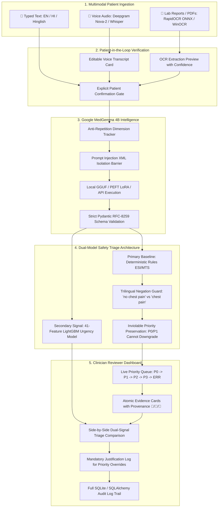

# CareFlow AI: MedGemma-Powered Multimodal Clinical Intake & Dual-Triage System

[](https://careflow-ai-d.streamlit.app/)
[](https://github.com/0mM1shra/careflow_ai)
[](https://www.python.org/)
[](https://fastapi.tiangolo.com/)
[](https://streamlit.io/)
[](https://huggingface.co/google/medgemma-1.5-4b-it)
[](https://lightgbm.readthedocs.io/)

> 🌐 **Live Cloud Demo**: **[https://careflow-ai-d.streamlit.app/](https://careflow-ai-d.streamlit.app/)**  
> 🔑 **Clinician Reviewer PIN**: `CAREFLOW`  
> 💻 **GitHub Repository**: **[https://github.com/0mM1shra/careflow_ai](https://github.com/0mM1shra/careflow_ai)**

---

## ⚠️ Clinical Research & Hackathon Disclaimer
**CareFlow AI is an experimental clinical decision-support and intake assistant prototype.** It is **NOT** a certified medical diagnostic device or an autonomous emergency triage service. CareFlow does not prescribe medication, diagnose illnesses, or replace licensed medical judgment. All clinical summaries, urgency scores, and extracted findings **must be reviewed and approved by a qualified healthcare professional** before medical decisions are made. In an emergency, dial **112 / 911** or visit the nearest emergency department immediately.

---

## 1. Executive Summary & Problem Solved

### The Clinical Bottleneck
Emergency Departments (ED) and outpatient clinics face severe overcrowding, long waiting lines, and critical triage delays. In diverse healthcare landscapes like India, these challenges are compounded by:
1. **Multilingual Barriers**: Patients express distress across English, Devanagari Hindi, and regional colloquialisms (Hinglish like *"seene me dard hai"*, *"saans phool rahi hai"*).
2. **Cognitive Burden on Clinicians**: Doctors spend excessive time gathering repetitive baseline history rather than making high-acuity interventions.
3. **Safety Risks of Black-Box LLMs**: Unconstrained generative LLMs can hallucinate diagnoses, provide unsafe advice, or silently drop life-threatening red flags.

### CareFlow's Solution
CareFlow introduces an **auditable, multimodal clinical intake and dual-signal triage system** that decouples generative conversation from safety-critical decision logic:
- **Google MedGemma 4B SLM** (with custom fine-tuned LoRA adapter `careflow-medgemma-final` and 4-bit quantized local GGUF) handles adaptive bilingual dialogue, question generation, and structured 6-field clinical entity extraction.
- **Deterministic Rule-Based Triage Engine (Emergency Severity Index / Manchester Triage System)** executes first with an inviolable escalation safeguard: emergency signals (`P0`/`P1`) can never be downgraded silently.
- **LightGBM Tabular Urgency Classifier** provides an independent secondary probability signal trained on 41 continuous vitals and clinical categorical features.
- **Native Document OCR (RapidOCR PP-OCRv4 ONNX)** automatically ingests medical lab reports (e.g., Apollo Complete Blood Counts, extracting platelets, WBC, and vitals) and passes findings directly into dialogue context.
- **Clinician-in-the-Loop Review Dashboard** provides complete source provenance tracking (identifying whether evidence came from 🎤 Voice, 📄 OCR, or 💬 Typed text), with mandatory justification logging for triage overrides.

---

## 2. End-to-End System Architecture



---

## 3. GitHub Repository Structure & Codebase Guide

```
careflow_ai/
├── backend/                             # Core FastAPI backend services & routes
│   ├── api/
│   │   └── routes.py                    # Complete REST API (/cases, /messages, /next-question, /submit, etc.)
│   ├── models/
│   │   └── lgbm_urgency_model.joblib    # Pre-trained 41-feature LightGBM triage artifact
│   ├── schemas/
│   │   ├── clinical.py                  # Pydantic schemas for patient intake, evidence, and validation
│   │   └── triage.py                    # Triage priority output contracts (P0, P1, P2, P3, ERR)
│   ├── services/
│   │   ├── medgemma.py                  # Google MedGemma 4B service (Local GGUF, PEFT, Ollama, API, Mock)
│   │   ├── ocr_service.py               # RapidOCR ONNX, WinOCR, PaddleOCR, and PDF extraction
│   │   ├── transcription.py             # Voice STT (Deepgram Nova-2 SDK & faster-whisper fallback)
│   │   ├── translation.py               # Pure neural translation to idiomatic Devanagari Hindi
│   │   ├── triage_rules.py              # Deterministic clinical triage protocol & negation guard
│   │   ├── safety.py                    # Prompt injection containment & clinical safety validator
│   │   ├── extraction.py                # Structured clinical entity and symptom extraction
│   │   ├── questioning.py               # Anti-repetition clinical question selection router
│   │   └── summarization.py             # Grounded clinical summary synthesis with verbatim citations
│   ├── config.py                        # Central settings (timeouts, paths, quantization, model modes)
│   ├── database.py                      # SQLAlchemy ORM models, foreign keys, and automatic schema migrations
│   ├── main.py                          # FastAPI application initialization, CORS, and startup hooks
│   └── ml_triage_service.py             # LightGBM feature alignment, inference, and explainability
│
├── frontend/                            # Streamlit frontend user interfaces
│   ├── app.py                           # Application router and shared sidebar navigation
│   ├── api_client.py                    # Robust HTTP client with configurable 300s model timeouts
│   └── pages/
│       ├── patient.py                   # Patient Intake Portal (Trilingual chat, voice recorder, OCR upload)
│       ├── reviewer.py                  # Clinician Reviewer Dashboard (Priority queue, evidence provenance, overrides)
│       ├── architecture.py              # Live AI Model status, active runtimes, and system topology
│       └── evaluation.py                # Visual evaluation benchmark runner (Policy trials & pipeline fixtures)
│
├── careflow-medgemma-final/             # Fine-tuned MedGemma LoRA adapter weights & tokenizer
│   ├── adapter_config.json              # LoRA rank (r=8, alpha=16, target modules: q, k, v, o, gate, up, down)
│   ├── adapter_model.safetensors        # Trained LoRA adapter tensors (6,000 bilingual clinical dialogue turns)
│   ├── tokenizer.json                   # Gemma-3 BPE tokenizer
│   └── chat_template.jinja              # Exact prompt template for MedGemma instruction tuning
│
├── careflow_lightgbm_training_dataset.csv # 41-feature clinical training dataset for LightGBM
├── models/
│   ├── lightgbm_triage.pkl              # Pickled LightGBM classifier artifact
│   └── medgemma-4b-it-Q4_K_M.gguf       # Quantized 4-bit Google MedGemma GGUF model (local neural execution)
│
├── scripts/
│   ├── download_model.py                # Automated streaming downloader with resume for MedGemma 4B GGUF
│   ├── train_lightgbm.py                # Re-training script for LightGBM tabular urgency classifier
│   └── test_ocr_upload.py               # E2E test script creating a synthetic Apollo CBC lab report
│
├── evaluation/                          # Research benchmark suites
│   ├── eval_policies.py                 # Multi-policy questioning benchmark (Fixed vs MedGemma vs CareFlow-BQ)
│   └── run_eval.py                      # 7-scenario clinical pipeline verification suite
│
├── tests/                               # Comprehensive pytest suite (100+ verified passing unit & E2E tests)
│   ├── test_api.py                      # REST API endpoint contracts
│   ├── test_clinical_voice_triage_regression.py # Voice provenance and triage preservation
│   ├── test_eval_policies.py            # Questioning policy budget evaluations
│   ├── test_intake_500_and_voice.py     # Multimodal ingestion and regression tests
│   ├── test_ml_triage.py                # LightGBM feature routing and dual-triage guardrails
│   ├── test_multilingual.py             # Devanagari Hindi and Hinglish cross-turn understanding
│   ├── test_ocr_service.py              # RapidOCR ONNX report reading and vitals ingestion
│   ├── test_safety_fixes.py             # Denial integrity and interim escalation persistence
│   └── test_triage_rules.py             # Deterministic ESI/MTS rule engine validation
│
├── CareFlow_MedGemma_GPU_Colab.ipynb    # Free Google Colab T4 GPU notebook with vLLM / ngrok API bridge
├── benchmark_inference.py               # Inference latency and token-per-second profiling benchmark
├── run_ab_test.py                       # A/B Model Showdown (Base MedGemma vs Fine-Tuned MedGemma)
├── LOCAL_WINDOWS_TEST.md                # Dedicated Windows 11 setup and PowerShell tips
├── requirements.txt                     # Pinned project dependencies
└── README.md                            # Comprehensive project documentation
```

---

## 4. How Each Core Module Works

### 1. MedGemma Neural SLM Engine (`backend/services/medgemma.py`)
- **Model Family**: Google MedGemma 4B Instruction-Tuned (`google/medgemma-1.5-4b-it`).
- **Local Neural Execution**: Powered by `llama-cpp-python` with AVX2 CPU vectorization. If an NVIDIA GPU is detected (`torch.cuda.is_available()`), it automatically passes `n_gpu_layers=-1` to offload all model layers to VRAM.
- **Fine-Tuned LoRA Adapter**: Trained on 6,000 diverse bilingual clinical intake turns (`careflow-medgemma-final`).
- **Strict 6-Field Output Contract**:
  ```json
  {
    "primary_system_flag": "sys_cardiopulmonary",
    "red_flag_severe_pain": true,
    "red_flag_acute_onset": true,
    "target_triage_boundary": "P1",
    "next_question_en": "Are you experiencing any shortness of breath or dizziness?",
    "next_question_hi": "क्या आप सांस लेने में तकलीफ या चक्कर महसूस कर रहे हैं?"
  }
  ```
- **Output Normalization**: `_normalize_triage_turn_payload` guarantees that model outputs map strictly to clinical schema bounds with zero crashes.
- **Idiomatic Hindi Translation**: `backend/services/translation.py` ensures that all follow-up questions render in pure Devanagari Hindi.

### 2. Native RapidOCR Document Ingestion (`backend/services/ocr_service.py`)
- **Technology**: `rapidocr-onnxruntime` (PP-OCRv4 ONNX model) with zero external C++ build requirements.
- **Capabilities**: Reads lab reports, discharge summaries, and prescription images (JPEG, PNG, WebP, PDF).
- **Clinical Biomarker Extraction**: Automatically parses Complete Blood Count (CBC) panels:
  - Platelet Count (e.g., detects critical thrombocytopenia `< 50,000 /uL`)
  - Total Leukocyte Count (WBC) (e.g., detects severe leukocytosis / infection `> 15,000 /uL`)
  - Hemoglobin, Blood Pressure, Heart Rate, and SpO2.
- **Dialogue Injection**: Extracted lab abnormalities are injected into MedGemma's `<extracted_report>` XML tags, prompting the SLM to prioritize questions regarding high-risk lab values.

### 3. Voice Transcription & Speech-to-Text (`backend/services/transcription.py`)
- **Primary Engine**: Deepgram Nova-2 Python SDK with Indian accent and Hindi/Hinglish speech recognition (`en-IN` / `hi`).
- **Local Fallback**: `faster-whisper` (`base` / `tiny`) running locally on CPU.
- **Patient Confirmation Card**: Transcripts are presented to the patient in an editable card with an acoustic confidence indicator. The text is only committed to the case after explicit confirmation.

### 4. Dual-Model Safety Triage Architecture
CareFlow prevents AI over-reliance by using two independent triage signals:
1. **Primary Baseline — Deterministic Rule Triage (`backend/services/triage_rules.py`)**:
   - Implements established Emergency Severity Index (ESI) and Manchester Triage System (MTS) protocols.
   - Evaluated first. **Escalation Preservation Rule**: A case tagged as `P0` or `P1` can never be downgraded silently.
   - **Trilingual Negation Guard (`_is_negated`)**: Examines contextual negation cues (*"no"*, *"without"*, *"denies"*, *"नहीं"*, *"nahi"*, *"nahi hai"*) across clause boundaries, ensuring symptom denials do not trigger false alarms.
2. **Secondary Signal — LightGBM Tabular Classifier (`backend/ml_triage_service.py`)**:
   - Trained across 41 tabular features (`models/lightgbm_triage.pkl`).
   - Ingests continuous vitals, calculated metrics (`shock_index = HR / SBP`, `MAP = (2*DBP + SBP) / 3`), and MedGemma categorical flags.
   - Outputs a secondary urgency category (`ml_model_priority`) and confidence score (`ml_confidence`) for clinician review.

### 5. Clinician Reviewer Dashboard (`frontend/pages/reviewer.py`)
- **Real-Time Priority Queue**: Sorts cases by acuity (`P0` -> `P1` -> `P2` -> `P3` -> `ERR`) and wait time.
- **Evidence Provenance Badges**: Every piece of extracted clinical data cites its exact source modality (`🎤 Voice`, `📄 OCR Document`, or `💬 Typed Text`) alongside verbatim patient quotes.
- **Dual-Signal Comparison**: Side-by-side display of the Deterministic Rule Baseline vs. LightGBM ML prediction.
- **Auditable Overrides**: Clinicians can modify the triage priority or edit summaries, but every override strictly requires a mandatory justification reason logged in the immutable SQLite audit trail.

---

## 5. Reviewer Quickstart: Local PC Deployment Guide

Follow these steps to deploy and test CareFlow on your local machine (**Windows 10/11, Ubuntu/Debian Linux, or macOS**).

### Prerequisites
- **Python**: Version **3.10, 3.11, or 3.12** installed.
- **Git**: Installed and available in terminal.
- **Hardware**: Standard modern laptop or desktop (16 GB RAM recommended; works with CPU-only or NVIDIA GPU).

---

### Step 1: Clone the Repository

```bash
git clone https://github.com/0mM1shra/careflow_ai.git
cd careflow_ai
```

---

### Step 2: Set Up Virtual Environment

#### On Windows (PowerShell):
```powershell
# If script execution is restricted:
Set-ExecutionPolicy -Scope Process -ExecutionPolicy RemoteSigned -Force

python -m venv .venv
.\.venv\Scripts\Activate.ps1
```

#### On Linux / macOS:
```bash
python3 -m venv .venv
source .venv/bin/activate
```

---

### Step 3: Install Dependencies

```bash
python -m pip install --upgrade pip
pip install -r requirements.txt
```

*(Optional for GPU acceleration)*: If your PC has an NVIDIA GPU with CUDA, install the CUDA-enabled PyTorch build:
```bash
pip install torch torchvision --index-url https://download.pytorch.org/whl/cu121
```

---

### Step 4: Configure Environment Variables

Create your local `.env` configuration file from the template:

#### Windows PowerShell:
```powershell
Copy-Item .env.example .env
```

#### Linux / macOS:
```bash
cp .env.example .env
```

---

### Step 5: Choose Your SLM Inference Mode

CareFlow supports three model modes configured via `MEDGEMMA_MODE` in `.env`:

#### Option A: Instant Reviewer Mode (`MEDGEMMA_MODE=mock`) — *Recommended for Quick Evaluation*
- **Requires zero download** and uses zero model RAM.
- Executes an internal deterministic clinical parser that extracts symptoms, vitals, onset, severity, and denials across English and Hindi in `< 5 ms`.
- To enable, ensure your `.env` contains:
  ```ini
  MEDGEMMA_MODE=mock
  ENABLE_MOCK_FALLBACK=true
  ```

#### Option B: 100% Real Neural SLM on Local PC (`MEDGEMMA_MODE=local`) — *Full Neural Experience*
- Runs the real quantized Google MedGemma 4B GGUF model (`medgemma-4b-it-Q4_K_M.gguf`, 2.31 GB) locally using `llama-cpp-python` with AVX2 CPU acceleration (or automatic CUDA offload if a GPU is present).
- **Run the automated model downloader**:
  ```bash
  python scripts/download_model.py
  ```
  *(Downloads the weights into `models/medgemma-4b-it-Q4_K_M.gguf` with streaming resume support).*
- Update `.env`:
  ```ini
  MEDGEMMA_MODE=local
  ENABLE_MOCK_FALLBACK=false
  MODEL_TIMEOUT_SECONDS=300
  MEDGEMMA_LOCAL_GGUF_PATH=models/medgemma-4b-it-Q4_K_M.gguf
  ```

#### Option C: Free Google Colab T4 GPU Hosting (`MEDGEMMA_MODE=hosted`)
- Open the included Jupyter Notebook [`CareFlow_MedGemma_GPU_Colab.ipynb`](CareFlow_MedGemma_GPU_Colab.ipynb) on [Google Colab](https://colab.research.google.com/).
- Run the notebook with a free T4 GPU to expose a vLLM / ngrok endpoint.
- Paste your ngrok URL into `.env`:
  ```ini
  MEDGEMMA_MODE=hosted
  MEDGEMMA_ENDPOINT=https://your-colab-ngrok-url/v1/chat/completions
  ```

---

### Step 6: Launch the Backend Server

In your active terminal:
```bash
uvicorn backend.main:app --host 127.0.0.1 --port 8000
```
- ✅ **API Health Check**: [http://127.0.0.1:8000/health](http://127.0.0.1:8000/health)
- 📖 **Interactive Swagger Docs**: [http://127.0.0.1:8000/docs](http://127.0.0.1:8000/docs)
- 🤖 **Model Provider Status**: [http://127.0.0.1:8000/model-providers](http://127.0.0.1:8000/model-providers)

---

### Step 7: Launch the Streamlit Frontend

Open a **second terminal**, activate `.venv`, and run:
```bash
streamlit run frontend/app.py --server.port 8501
```

- 🏥 **Patient Intake Portal**: [http://localhost:8501](http://localhost:8501)
- 🩺 **Clinician Reviewer Dashboard**: [http://localhost:8501](http://localhost:8501) *(Navigate via sidebar, PIN: `CAREFLOW`)*
- 🏗️ **AI Model Architecture Showcase**: [http://localhost:8501](http://localhost:8501) *(Click Architecture)*
- 📊 **Benchmark & Evaluation Suite**: [http://localhost:8501](http://localhost:8501) *(Click Evaluation)*

---

## 6. How Reviewers Can Test & Verify the System

CareFlow includes ready-to-run verification scripts and test suites for reviewers:

### 1. Run the Automated PyTest Suite
Runs **100+ verified test cases across 12 test modules** (passing in ~6 seconds with zero regressions):
```bash
pytest -v
```

### 2. Run the Live A/B Model Showdown
Directly compares the fine-tuned MedGemma model against the base instruction-tuned model across clinical relevance and vital signs triage:
```bash
python run_ab_test.py
```

### 3. Test Medical Lab Report OCR Ingestion
Creates a synthetic Apollo Complete Blood Count lab report image (with critical low platelets: 45,000 /uL, WBC: 18,500 /uL, and vitals), sends it to the running backend, and verifies that the SLM generates targeted infection follow-up questions:
```bash
python scripts/test_ocr_upload.py
```

### 4. Run Standardized Clinical Pipeline Fixtures (7 Tests)
Executes 7 clinical scenarios (Acute Coronary P0, Febrile Meningeal P1, Severe Flank Pain P1, Contradictory Duration P2, Unknown Dimension P3, Routine Cold P3, and AI Failure Fallback ERR):
```bash
python -m evaluation.run_eval
```

### 5. Run Multi-Policy Questioning Benchmark (Budgets 4, 6, 8)
Benchmarks 4 question selection strategies across token budgets:
```bash
python -m evaluation.eval_policies
```

### 6. Verify Real-time AI Pipeline via Direct HTTP POST
Test the full end-to-end multimodal pipeline with a single `curl` command:
```bash
curl -X POST "http://127.0.0.1:8000/ai-pipeline/run" \
  -H "Content-Type: application/json" \
  -d '{
    "text": "I have severe pressure in my chest radiating to my left arm since 30 minutes",
    "vitals": {"heart_rate": 115, "systolic_bp": 155, "spo2_pct": 93},
    "preferred_language": "Hindi"
  }'
```
**Expected Response**:
- `primary_system_flag`: `"sys_cardiopulmonary"`
- `red_flag_severe_pain`: `true`
- `red_flag_acute_onset`: `true`
- `target_triage_boundary`: `"P1"`
- `rule_based_triage`: `{"priority": "P0", "label": "Emergency Escalation"}`
- `next_question_hi`: Natural Devanagari Hindi translation.

---

## 7. Triage Priority Operational Protocol

| Priority | Level | Clinical Criteria & Example Symptoms | Operational Action | Safeguard Behavior |
| :---: | :--- | :--- | :--- | :--- |
| **P0** | 🚨 Emergency Escalation | Chest pain radiating to arm/jaw, severe acute dyspnea, acute stroke (FAST), anaphylaxis, massive bleeding. | Immediate ED transfer / emergency resuscitation alert. | **Checked first. Cannot be downgraded by any subsequent question or model.** |
| **P1** | ⚠️ Urgent Review | High fever (>39°C) with neck stiffness, severe uncontrolled pain (>=8/10), acute central chest pain, acute abdomen. | Clinician evaluation within 1–2 hours. | **Interim P1 acuity is preserved across subsequent dialogue turns.** |
| **P2** | ❓ Incomplete / Conflicting | Contradictory onset timelines across turns, clinical ambiguity, skipped questions. | Targeted clinician re-interview or clarifying callback. | Flags specific contradictions for clinician attention. |
| **P3** | 📋 Routine Review | Stable, mild-to-moderate symptoms without red flags, normal vitals, cold/cough. | Standard outpatient queue for scheduled consultation. | Default review tier for non-urgent cases. |
| **ERR** | ⚠️ AI Review Required | Schema parsing failure after bounded retries or network disruption. | Manual nurse/doctor triage. | **System never silently defaults to a routine P3 tier upon error.** |

---

## 8. REST API Reference Summary

| Method | Endpoint | Description |
| :--- | :--- | :--- |
| `GET` | `/health` | Reports backend operational status, SQLite connection, and MedGemma readiness |
| `GET` | `/model-providers` | Lists active SLM runtimes (`local_neural_slm`, `peft_local_gpu`, `hosted`) |
| `POST` | `/cases` | Registers a new patient intake and generates a secure Case ID (e.g., `CF-2026-XXXX`) |
| `GET` | `/cases` | Retrieves patient queue sorted by priority (`P0` -> `P1` -> `P2` -> `P3` -> `ERR`) |
| `GET` | `/cases/{id}` | Fetches full case details, evidence state, messages, and audit trail |
| `POST` | `/cases/{id}/messages` | Appends patient message, updates evidence, runs interim red-flag checks |
| `POST` | `/cases/{id}/next-question` | Generates next targeted follow-up question via MedGemma SLM |
| `POST` | `/transcribe-audio` | Transcribes voice audio via Deepgram / Whisper without auto-committing |
| `POST` | `/cases/{id}/upload-document` | Uploads and extracts text from medical lab report / prescription via RapidOCR |
| `POST` | `/cases/{id}/extract-document` | Previews OCR text extraction without committing to case record |
| `POST` | `/cases/{id}/submit` | Finalizes intake, computes dual triage, and synthesizes clinical draft summary |
| `POST` | `/cases/{id}/review` | Saves clinician edits, clinical notes, and approval status |
| `POST` | `/cases/{id}/override-priority` | Overrides triage tier with mandatory recorded justification (audit-logged) |
| `POST` | `/cases/{id}/reopen` | Reopens an approved case for additional patient clarification |
| `POST` | `/ai-pipeline/run` | Real-time intake pipeline sandbox (runs SLM, LightGBM, and Rules in one call) |

---

## 9. Technology Stack & Provenance

- **Core Frameworks**: [FastAPI](https://fastapi.tiangolo.com/) (Async Python backend) & [Streamlit](https://streamlit.io/) (Interactive clinician & patient UI).
- **Generative SLM**: [Google MedGemma 4B Instruction-Tuned](https://huggingface.co/google/medgemma-1.5-4b-it) fine-tuned with LoRA (Unsloth PEFT) and quantized via GGUF format (`llama-cpp-python`).
- **Tabular ML Classifier**: [LightGBM](https://lightgbm.readthedocs.io/) trained on 41 clinical and vital sign dimensions.
- **OCR Engine**: [RapidOCR](https://github.com/RapidAI/RapidOCR) with ONNX Runtime & Windows Native WinRT OCR.
- **Voice STT**: [Deepgram Nova-2](https://deepgram.com/) Python SDK & [faster-whisper](https://github.com/SYSTRAN/faster-whisper).
- **Database**: SQLite with [SQLAlchemy](https://www.sqlalchemy.org/) ORM, foreign keys, and dynamic schema migrations.
- **Testing**: [pytest](https://docs.pytest.org/) test suite with 100+ tests and evaluation suites.

---

## 10. Contributors & License

CareFlow AI was engineered for the **Inter IIT Tech Meet / General Championship**.

- **Repository**: [https://github.com/0mM1shra/careflow_ai](https://github.com/0mM1shra/careflow_ai)
- **Author**: Om Mishra ([@0mM1shra](https://github.com/0mM1shra))
- **Contributor**: Sutirth Dubey ([@Sutirthdubey20005](https://github.com/Sutirthdubey20005))
- **License**: MIT License (Open Research & Educational Use).
